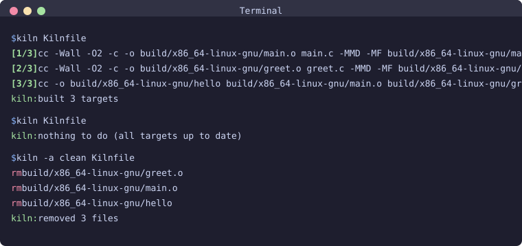

# kiln

[](https://github.com/OrangeTide/kiln/actions/workflows/ci.yml)
[](#license)
[](#)
[](#)

A build system with Tcl-based build descriptions, hybrid staleness
detection, and zero dependencies.

<p align="center">
  
</p>

## Features

- **Tcl build descriptions** - write build rules in a real language, not
  a DSL with sharp edges
- **Hybrid staleness** - stat fingerprint (fast path) + content hash +
  command string hash. Changing compiler flags triggers a rebuild
  automatically
- **Compiler depfile support** - parses `cc -MMD` output for automatic
  header dependency tracking
- **Tool tracking** - declare the compiler or script a rule runs with
  `uses`; changing that tool triggers a rebuild
- **Cross-compilation** - `--triplet` flag, artifacts in
  `build/<triplet>/` so builds don't collide
- **Zero dependencies** - single static binary, bootstraps with one
  `cc` command
- **Colored progress output** - `[n/m]` counter with automatic TTY
  detection, respects `NO_COLOR`

## Quick Start

```sh
# Bootstrap kiln (requires a C compiler)
sh bin/bootstrap.sh

# Or build manually
cc -O2 -o kiln bootstrap.c
```

## Usage

```sh
kiln                         # build the default target from ./Kilnfile
kiln app test                # build the named targets and their dependencies
kiln -f other.kiln           # read a build description other than ./Kilnfile
kiln -a clean                # delete outputs and depfiles, remove empty dirs
kiln -n                      # dry run (print commands only)
kiln --triplet arm-linux-gnueabihf   # cross-compile
```

kiln reads `./Kilnfile` by default; pass `-f` one or more times to read
other files. Any non-option arguments are targets to build: a file name a
rule produces, a `phony` task, or an `alias`. With no targets, kiln builds
the `default` declared in the Kilnfile, or every target if none is
declared. A requested target builds only itself and what it depends on.

## Example Kilnfile

```tcl
set cflags "-Wall -O2"

rule build/$Triplet/greet.o {
    inputs greet.c
    depfile build/$Triplet/greet.d
    command {cc $cflags -c -o $out $in -MMD -MF $depfile}
}

rule build/$Triplet/main.o {
    inputs main.c
    depfile build/$Triplet/main.d
    command {cc $cflags -c -o $out $in -MMD -MF $depfile}
}

rule build/$Triplet/hello {
    inputs build/$Triplet/main.o build/$Triplet/greet.o
    command {cc -o $out $in}
}
```

The `rule` command declares outputs, inputs, an optional depfile, and a
shell command. Variables like `$out`, `$in`, and `$depfile` are set
automatically. Since the body is Tcl, you have control flow (`if`,
`while`, `for`, `foreach`), list commands (`list`, `lappend`, `lindex`,
`llength`), `string`, `proc`, `catch`, `glob`, `file`, and `exec` (run a
program at parse time and capture its output, for compiler or host
probing). A rule per source is just a loop:

```tcl
set objs {}
foreach s [glob *.c] {
    set o build/$Triplet/[file rootname $s].o
    lappend objs $o
    cc_object $o $s $o.d "-Wall -O2"
}
rule build/$Triplet/app {
    inputs $objs
    command {cc -o $out $in}
}
```

Use `uses` to declare a program a rule runs, such as a compiler or a
generator script, when it is not already an input. kiln tracks it for
staleness like an input, so changing the tool rebuilds, and if the tool
is itself a build output it is built first:

```tcl
rule build/$Triplet/parser.c {
    inputs parser.peg
    uses build/$Triplet/peg
    command {build/$Triplet/peg $in > $out}
}
```

To avoid repeating `build/$Triplet/` on every path, set a build
directory prefix with the `builddir` command (or the `--builddir`
flag) and write outputs as plain paths. kiln prepends the prefix to
rule outputs and depfiles automatically, and resolves inputs that name
a prefixed build output.

A rule may write into a subdirectory that does not exist yet. kiln
creates the parent directory of each output and depfile before running
the command, so a build can mirror a nested source tree without a
`mkdir` step.

## Phony Targets

A `phony` target runs a command but produces no file, for tasks like
running or testing:

```tcl
phony run {
    inputs app
    command {./app}
}
```

Because a phony target has no output to prove it is up to date, it runs
whenever the build reaches it. Name it on the command line (`kiln run`) to
run it on demand instead of on every build.

## Default Targets and Aliases

`default` names the target or targets to build when the command line names
none. `alias` gives one name to a list of targets, so a single word can
stand for many:

```tcl
default app
alias check {test-parser test-lexer}
```

With this, `kiln` builds `app`, and `kiln check` runs both test targets. An
alias may refer to other aliases; kiln expands them until it reaches real
targets.

## Standard Library

A small standard library (`lib/kiln.tcl`) is bundled into the binary and
loaded before your Kilnfiles unless you pass `--no-stdlib`. It provides
helper procs that cut rule boilerplate:

```tcl
builddir build/$Triplet

# Compile every C source and link them into one program
cc_program app [glob *.c] "-Wall -O2"
```

The helpers are:

- `cc_program out sources flags` - compile each source and link into `out`
- `cc_objects sources flags` - compile each source into a mirrored object tree, returning the object list
- `cc_object obj src dep flags` - compile one source with depfile tracking
- `cp_rule dst src` - copy as a build step
- `run name program opts` - build `program`, then launch it (see below)
- `test name program opts` - run a test program; a non-zero exit fails the build

The compiler is the global `CC`, defaulting to `cc`. Override it from
the environment (`CC=clang kiln ...`) or by setting it in the Kilnfile
before declaring rules, and set it per target to cross-compile. Use
`getenv name ?default?` to read any environment variable with a
fallback, for other toolchain settings.

The library is edited as `lib/kiln.tcl` and embedded with
`sh bin/embed.sh`, which regenerates `src/kiln_stdlib.h`. The helper set
will grow as kiln's Tcl surface does.

## Running and Testing

`run` and `test` turn a built program into a target you can invoke. They
declare a phony target that depends on the program, so it is built first,
then launch it:

```tcl
cc_program app [glob *.c] "-O2"
run app-run app {}             # kiln app-run  ->  builds app, runs ./app
test parser app {--self-test}  # kiln parser   ->  runs ./app --self-test
```

The third argument is extra command-line options (`{}` for none). A
non-zero exit fails the build, and kiln prints the target, the command,
and its output, just as it does for a failing compile.

To run a cross-compiled binary through an emulator, set the global `RUN`
(empty by default, so programs run natively):

```tcl
set RUN [getenv RUN qemu-arm]
```

With this, `run` and `test` launch `qemu-arm ./app` instead of `./app`.
Because the program is tracked as an input, changing the compiler or a
source rebuilds it before the next run.

## Build Variants

A variant is a named set of flags with its own build directory, so debug,
release, and sanitizer builds coexist without duplicating rules. Set the
common flags, then declare one `variant` per configuration:

```tcl
set CFLAGS "-Wall -Wextra"
variant release {-O2 -DNDEBUG}
variant debug   {-O0 -g}
variant asan    {-O1 -g -fsanitize=address}

cc_program app [glob *.c] $CFLAGS
```

`--variant NAME` selects the active one (default `release`):

```sh
kiln                  # build/<triplet>/release, -O2 -DNDEBUG
kiln --variant debug  # build/<triplet>/debug,   -O0 -g
kiln --variant asan   # build/<triplet>/asan,    -fsanitize=address
```

The active variant appends its flags to the globals `CFLAGS` and
`LDFLAGS` and sets the build directory to `build/<triplet>/<name>`, so
each variant keeps its own outputs and staleness database. A variant's
flags reach both compilation and linking, so a sanitizer that must be
passed to the linker works from a single entry. The globals start empty,
so a build depends only on the Kilnfile, not the ambient environment.

## How It Works

1. **Parse** - evaluate Kilnfiles in a Tcl interpreter (Picol 2),
   building a DAG of file and command nodes
2. **Sort** - topological sort with cycle detection
3. **Execute** - walk the DAG in order, checking each command for
   staleness before running it

Staleness is checked in three ways:

- **Stat fingerprint** (mtime, size, inode, ctime) - if unchanged, skip
  the file entirely (the fast path, one `stat()` call)
- **Content hash** - if stat changed but hash matches, the file was
  touched but not modified (e.g. `touch`)
- **Command string hash** - if the command changed (new flags, different
  compiler), rebuild even if inputs are identical

State is persisted in `build/<triplet>/kiln.cdb` using DJB's CDB format,
crash-safe via atomic rename.

## Documentation

- Online: <https://orangetide.github.io/kiln/> - landing page and
  rendered man page, published from `site/` by CI
- `doc/kiln.1` - man page (`man -l doc/kiln.1`)
- `HACKING.md` - developer guide
- `STYLE.md` - coding conventions

Build and preview the documentation site locally with
`make -C site serve` (requires `pandoc`).

The screenshot above is generated from real kiln output:

```sh
sh doc/gen-screenshot.sh
```

## Options

| Flag | Description |
|------|-------------|
| `-f F`, `--file F` | Read build description F (default `Kilnfile`; repeatable) |
| `-a clean` | Delete declared outputs and generated depfiles, then empty dirs |
| `-a status` | Report out-of-date targets and stale database entries |
| `--triplet T` | Set target triplet (skip `cc -dumpmachine`) |
| `--variant V` | Set build variant (default `release`) |
| `--builddir P` | Set build directory prefix for rule outputs |
| `--lib F` | Load a Tcl library before Kilnfiles (repeatable) |
| `--no-stdlib` | Skip the built-in standard library (`lib/kiln.tcl`) |
| `-n`, `--dry-run` | Print commands without running them |
| `-j N` | Run up to N commands in parallel (default: CPU count) |
| `-h`, `--help` | Show usage |

## Environment Variables

| Variable | Effect |
|----------|--------|
| `NO_COLOR` | Disable colored output ([no-color.org](https://no-color.org/)) |
| `CLICOLOR_FORCE` | Force color even when not a TTY |
| `TERM` | Color disabled when `dumb`, empty, or unset |
| `CC` | C compiler for the standard-library helpers (default `cc`) |
| `RUN` | Launch wrapper for `run`/`test`, e.g. an emulator (default none) |

`CC` and `RUN` are read by the standard library through `getenv`, so a
Kilnfile can override either before declaring rules.

## Amalgamation Build

A single-file amalgamation can be generated for easy distribution:

```sh
sh bin/amalgamation.sh > kiln-amalgamation.c
cc -O2 -o kiln kiln-amalgamation.c
```

The amalgamation resolves all local `#include "..."` directives into
one self-contained C file. No source tree needed to compile it.

## License

Dual-licensed under [MIT](https://opensource.org/licenses/MIT) OR
[Apache-2.0](https://www.apache.org/licenses/LICENSE-2.0), at your option.
